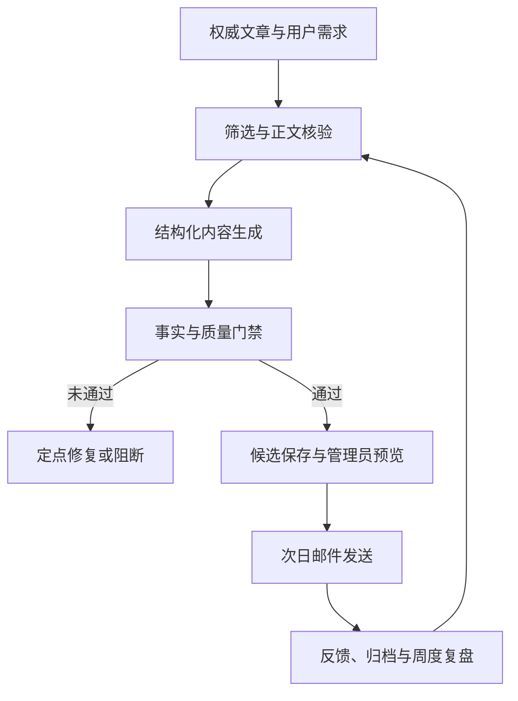

# 公考晨读邮件

> 一个从用户需求、内容产品设计到 AI 工作流与云端运营的端到端实践。

公考晨读邮件面向需要持续积累申论、面试和公基素材的备考者。它每天从权威文章中筛选可转化内容，生成框架、题目、表达和练习，经过事实与质量门禁后，通过邮件稳定交付。

这个项目不只是“用大模型生成一封邮件”。我希望验证的是：如何从真实需求出发，把不稳定的生成式 AI 能力组织成一个**可持续使用、可检查、可干预、可运营**的产品。

## 项目概览

| 维度 | 内容 |
| --- | --- |
| 用户问题 | 备考者每天筛选文章、理解内容并转成考场表达的成本高，普通新闻摘要又不能直接用于申论和面试 |
| 产品方案 | 将权威文章转化为 5—8 分钟可完成的结构化晨读，通过邮件低门槛交付 |
| 我的角色 | 产品负责人、用户研究与需求分析、AI 工作流设计、开发部署、内容质量运营、增长与商业化探索 |
| 研究输入 | 问卷与群内反馈、邮件使用反馈、非正式聊天访谈，以及我作为目标用户的长期痛点观察 |
| 当前状态 | 真实用户持续使用，邮件稳定发送；三条生成路径全部跑通，周 PDF 与 30 秒表达训练已上线 |
| 数据说明 | 本 README 不公开用户规模等敏感经营数据，重点展示方法、决策、系统和可验证产物 |

## 从问题出发，而不是从模型出发

最初的问题并不是“怎样接入一个大模型”，而是备考过程中的三个连续任务：

1. **筛选成本高**：每天有大量文章，但真正适合转成公考材料的内容有限。
2. **理解不等于会用**：看懂文章后，还要重新提炼考点、案例、作答结构和表达。
3. **积累难以持续**：资料分散在网页、笔记和聊天记录里，缺少稳定、低负担的练习节奏。

因此，产品目标被定义为：不是再做一个新闻摘要工具，而是把“找文章—读文章—转成考场材料—完成一次练习”压缩成一份可持续消费的晨读邮件。

## 用户研究与需求洞察

项目早期和迭代过程中，我持续收集四类输入：

- **问卷与群内反馈**：了解备考者平时如何找素材、哪些环节最耗时，以及希望保留哪些内容。
- **邮件使用反馈**：观察用户真正会读、会保存、会继续使用的模块，而不是只听功能偏好。
- **非正式聊天访谈**：了解用户对文章筛选、申论转化、面试表达和复习节奏的具体困难。
- **自身需求观察**：从个人的信息整理与学习需求提出初始假设，再通过备考用户的实际反馈检验。

这些输入逐渐形成了几项关键判断：

- 阅读习惯存在差异：部分用户选择框架图、今日一题和金句，部分用户通读或先看原文再对照总结，需要支持不同阅读路径。
- 用户需要的不是“知道今天发生了什么”，而是“这篇文章在考场上怎么分析、怎么答、怎么表达”。
- AI 内容如果偶尔出现事实错误、半句话、模块重复或题目权限失真，会快速损害信任。
- 对日更产品而言，生成能力只是起点；稳定送达、失败阻断、人工干预和持续复盘同样属于核心体验。

### 反馈如何推动迭代

早期反馈表按日期保存了多轮使用反馈，交流表记录了围绕阅读方式、常用模块、资料整理和输出困难的追问。以下为匿名归纳，结合仓库现有功能说明反馈与设计的对应关系：

| 记录中的具体反馈 | 需求判断 | 已落地的设计与后续反馈 |
| --- | --- | --- |
| 有用户主要看框架、金句和短练习，也有用户先读原文再对照总结 | 阅读路径不同，信息层次和入口应清晰 | 提供模块化阅读、框架图及原文入口；后续反馈认可框架更清楚、内容更易读 |
| 有用户觉得框架空泛、答案过于专业，还有反馈指出半句话和不完整答案 | 既要控制篇幅，也要给出完整、可模仿的示范 | 增加考生版参考答案，持续完善完整句与题目匹配检查；后续反馈认为示范答案更直观、回答思路更容易理解 |
| 多次提出打印、每周汇总和纸质积累需求 | 日常手机阅读与集中复习需要不同载体 | 上线周 PDF 汇编；记录中有用户确认收到 PDF 并用于积累 |
| 有用户主动提出打卡输出、一句话转化和复盘，并认可 30 秒表达 | 阅读之外需要低负担的输出练习 | 先提供 30 秒表达任务，后续扩展为带签名链接的表达训练网页；网页的长期使用效果仍需跟踪 |
| 有反馈指出模块重合、颜色层次不清、链接打不开 | 内容质量也包含阅读和访问体验 | 迭代模块边界、重点标记、移动端排版和链接检查；后续反馈包含排版改善与链接恢复可访问的记录 |

这些记录属于早期使用者的定性反馈，能够支持需求发现和迭代方向，尚不能证明总体满意度、留存提升或考试成绩改善。不同用户对删减篇幅、保留框架等建议也存在分歧，因此保留模块选择空间，并继续跟踪实际使用。原始记录含个人信息，不在公开仓库中发布。

## 如何把洞察转成需求

| 用户需求 | 产品要求 | 对应设计 |
| --- | --- | --- |
| 快速判断文章值不值得读 | 降低筛选成本 | 权威来源池、正文核验、历史去重和两阶段选文 |
| 看完能用于考试 | 从“摘要”转为“能力训练” | 文章框架图、今日一题、考生版答案、可用表达和迁移方法 |
| 只看重点也有收获 | 支持选择性阅读 | 阅读导引、今日 3 件事、Full/Lite 分层和移动端短段落 |
| 内容值得信任 | 对生成结果建立约束 | 原文证据、事实审稿、模块质检、P0/P1/P2 门禁和定点修复 |
| 每天稳定收到 | 把生成与发送解耦 | 夜间生成候选、早晨只发送已通过门禁的成品 |
| 出现问题可以停止 | 给运营者保留控制权 | 管理员预览、两步确认取消、OSS 候选状态阻断 |

需求优先级遵循一个原则：**先保证每天能稳定交付一份可信、可用的核心内容，再增加 PDF、训练和增长功能。**这使项目没有停留在 Demo，而是逐步形成了可运营链路。

## 产品方案与关键迭代

### 1. 从文章摘要转向考场转化

产品不直接把文章压缩成摘要，而是先判断文章是否包含具体问题、场景、矛盾和迁移空间，再生成框架、题目和表达。真题库只用于学习设问方式，不复制原题，也不作为事实来源。

### 2. 从“内容生成”转向“质量生产”

模型输出后仍需经过结构、事实、题目、表达、重复、移动端展示和免费版泄漏检查。严重问题进入 P0 门禁并触发模块级定点修复；修复后仍不合格的候选不会发送。

### 3. 从单一路径转向三条可替换交付路径

项目最终跑通了三种生成方式，并让它们共用同一套 Candidate Schema、质量门禁、渲染和发送链路：

1. **阿里云 FC 自动化路径**：定时抓取、生成、审核和保存候选。
2. **ChatGPT Skill 路径**：由技能完成生成与审核，再发布标准候选到 OSS。
3. **AI Agent 路径**：由受控工具和状态机完成选文、生成、审核、预览和发布。

这样做不是为了堆技术，而是降低单一平台、模型或调用方式变化带来的运营风险。

### 4. 从“自动发送”转向“可干预运营”

AI Agent 候选通过门禁后，先向管理员发送预览；预览成功才写入正式候选。管理员可通过带签名的两步确认链接取消次日发送，取消后候选门禁立即变为 fail，早晨发送链路自动阻断。

### 5. 从每日邮件扩展到复习与训练

在核心日更链路稳定后，项目继续上线周度 PDF 汇编和带签名链接的 30 秒申论表达训练，把“阅读—复习—输出”连接成更完整的学习闭环。

## 系统如何运行



核心链路采用“夜间生成候选、早晨读取成品”的两段式设计，避免早晨临时调用模型失败，也确保 `quality_gate.overall != ok` 的候选无法进入正式发送。

## 项目结果

- 三条生成路径均已跑通，并复用统一的质量和发送标准。
- 项目已有真实用户持续使用，日常邮件能够稳定生成和发送。
- 用户反馈已经实际推动模块优先级、移动端阅读、内容边界和质量规则迭代。
- 周度 PDF 汇编和 30 秒表达训练已完成上线与部署。
- 建立了从失败案例、自动修复、质量指标到周度复盘的持续改进机制。
- AI Agent 路径已于 2026-10-28 完成真实模型、管理员预览、OSS 保存、防重复和取消闸门的端到端验收。

## 我在项目中承担的工作

- **产品负责人**：定义目标用户、核心问题、产品边界、MVP 与阶段路线。
- **用户研究与需求分析**：整理问卷、群反馈、邮件反馈与非正式访谈，将输入转成模块和优先级。
- **AI 工作流设计**：设计选文、生成、审核、修复和 Agent 编排，明确模型与确定性规则的边界。
- **开发与部署**：完成 Python 业务代码、阿里云 FC、OSS、SMTP、Render 服务和 GitHub Actions。
- **内容与质量运营**：建立事实安全、P0 门禁、回归样例、质量指标、失败留档和周度复盘。
- **增长与商业化探索**：设计 Full/Lite 分层、小红书内容入口、订阅交付和训练功能。

## 这个项目体现的能力

| 岗位方向 | 项目中的对应实践 |
| --- | --- |
| 咨询 / 业务分析 | 从模糊痛点拆解问题，结合多源反馈形成判断，并把建议落实为流程和可验证结果 |
| 产品经理 | 用户研究、需求分析、优先级、MVP、功能迭代、风险控制和运营闭环 |
| AI 产品 / AI 应用 | Prompt、结构化输出、Agent 工具、评估门禁、人机协同和多模型容错 |
| 项目交付 | 从方案到开发、云部署、验收、监控、回滚和文档沉淀的端到端推进 |

## 产品体验与公开入口

一封晨读邮件主要包含文章框架图、今日一题、今日可带走、原文入口和关联速读，读者可以在约 5—8 分钟内完成一次阅读与练习。

项目目前处于公测阶段。想了解邮件样例或订阅方式，可以通过[公考晨读的小红书主页](https://www.xiaohongshu.com/user/profile/69eca3fc000000000103d800)在站内联系维护者。GitHub Star 是对代码项目的支持，**不会自动订阅邮件**；本仓库也没有面向公众开放的自助订阅 API。

## 自行部署与调用

下面的入口面向自行部署项目的开发者；密钥、邮箱授权码和真实订阅者数据只应配置在自己的运行环境中。

1. 准备 Python 3.10、阿里云函数计算、模型 API Key 和邮件 SMTP 配置；跨实例保存候选件与历史记录时配置 OSS。
2. 参考 [`.env.example`](.env.example) 在函数计算控制台设置环境变量。先用 `RUN_MODE=test`、`TEST_LLM_MODEL=mock`、`SEND_EMAIL=false` 验证，不发送正式邮件。
3. Windows 可运行 `powershell -ExecutionPolicy Bypass -File .\scripts\build_fc_package.ps1` 生成 `function.zip`；Linux / WSL 可运行 `bash scripts/build_fc_package.sh`。
4. 将部署包上传到阿里云函数计算，日常函数入口设为 `main.handler`。完整检查与部署步骤见 [部署说明](docs/deploy_aliyun_fc.md)。

日常邮件使用函数计算事件调用：`{"mode":"nightly_candidate"}` 在夜间生成并审核次日候选，`{"mode":"morning_send"}` 在早晨只发送已通过门禁的成品。

其他入口按用途独立部署：

| 入口 | 调用方式 | 用途 |
| --- | --- | --- |
| `agent.fc_entry.handler` | FC 定时事件 + 带签名的 HTTP 取消链接 | 独立 AI Agent 生成、审核、预览并保存次日候选；部署见 [Agent 部署说明](docs/agent_deploy.md) |
| `fc_weekly_render.handler` | 带 Bearer Token 调用 `POST /weekly-render` | 用 6 份每日数据离线渲染周 PDF |
| `render_practice:app` | 订阅邮件中的专属签名链接 | 30 秒申论表达训练网页 |

截至 2026-10-28，AI Agent 路径已完成真实模型与隔离 OSS 的端到端验收。正式启用时，应暂停原 `nightly_candidate` 写入器、保留 `morning_send`，再将 Agent 从隔离前缀切换到生产候选前缀。

## 开发维护说明

AI Coding / Codex / Cursor 接手项目时，请先看 `AGENTS.md`；内容 Harness 文档索引见 `content_harness/00_index.md`。

知识库样例沉淀见 `knowledge/README.md`。每周至少新增 2 个反例和 1 个正例，用于持续完善 Prompt、质检和题型转换方法。
可用 `python scripts\check_knowledge_base.py` 检查本周沉淀数量。

周度质量复盘可运行：

```powershell
python scripts\weekly_quality_review.py --metrics output\harness_metrics.jsonl
```

脚本会输出 `weekly_harness_review_YYYY-WW.md` 和同名 JSON，汇总 P0/P1/P2、模块分布、重写成功率、P0 二次修复成功率、管理员报告和早晨发送成功率，并形成下一周 Harness 升级清单。

日常生产入口函数为：

```text
main.handler
```

## 独立周 PDF 离线渲染入口

供周末 PDF 汇编技能调用的独立 HTTP 入口为：

```text
fc_weekly_render.handler
```

建议在阿里云 FC 中创建独立函数并复用同一代码包，不要把该 HTTP
入口路由到 `main.handler`。函数只接受 6 个已生成的 daily JSON 和一份
完整 enrichment；不读取生产 archive，不上传 OSS，不发送邮件，不写
candidate，不修改订阅表，不抓网页，也不调用模型。

必须配置：

```text
WEEKLY_RENDER_TOKEN=<高熵随机 Bearer Token>
WEEKLY_RENDER_MAX_ZIP_BYTES=4000000
```

请求示例：

```http
POST /weekly-render
Authorization: Bearer <secret>
Content-Type: application/json

{
  "start_date": "2026-09-05",
  "end_date": "2026-09-11",
  "days": [{}, {}, {}, {}, {}, {}],
  "enrichment": {
    "exam_map_cards": [],
    "selected_expression_rows": [],
    "material_cards": [],
    "practice_questions": []
  }
}
```

成功响应为 `application/zip`（FC 响应体使用 base64 编码），ZIP 只包含
完整版 PDF、lite-preview PDF 和 `weekly_pdf_delivery_report.json`。
失败响应为 JSON，并包含稳定的 `issue_code`。请求中的 6 天可以因明确
停更而不连续，但必须严格升序、日期唯一且全部落在请求区间内；服务端不会
补齐缺失日期。

部署时必须确保 `typst --version` 可执行；导出器依次查找 PATH、
`/opt/bin/typst` 和代码包内 `bin/typst`。同步 ZIP 默认限制为 4 MB，
以给 base64 膨胀和 FC HTTP 响应限制留出空间；超过上限会返回
`weekly_render_response_too_large`，不会上传到临时外部存储。

## 部署打包

部署包统一命名为：

```text
function.zip
```

Windows 本地推荐执行：

```powershell
powershell -ExecutionPolicy Bypass -File .\scripts\build_fc_package.ps1
```

Linux / WSL / Git Bash 可执行：

```bash
bash scripts/build_fc_package.sh
```

两种脚本都为 FC Python 3.10 Linux x86_64 安装依赖，并通过统一 ZIP 检查：入口、周 PDF 模块、依赖和知识库必须齐全，路径必须使用 `/`，不能包含 Windows `.pyd`、缓存或嵌套 ZIP。安装、编译或检查失败时不能交付部署包。

生成 `function.zip` 后上传到阿里云函数计算。GitHub Actions 下载的 `function-zip.zip` 是产物外层包装，请先解压，上传里面的 `function.zip`；不要将外层包装直接部署，也不要再套一层 ZIP。代码包根目录应直接看到 `fc_weekly_render.py`，`weekly_typst_export.py` 同样放在根目录；`scripts/build_weekly_package.py` 放在 `scripts/`。周 PDF 入口保持 `fc_weekly_render.handler`，Typst 二进制仍须由运行环境或 Layer 提供。详细步骤见 `docs/deploy_aliyun_fc.md`。

## 必填环境变量

```text
RUN_MODE=prod
DASHSCOPE_API_KEY=你的百炼 API Key
SMTP_HOST=smtp.qq.com
SMTP_PORT=465
SMTP_USER=发件 QQ 邮箱
SMTP_PASSWORD=QQ 邮箱 SMTP 授权码
MAIL_FROM=发件 QQ 邮箱
RECIPIENTS=收件人1@qq.com,收件人2@qq.com
SEND_MODE=bcc
ATTACH_DAILY_PDF=false
HISTORY_STORAGE=local
OSS_ENDPOINT=
OSS_BUCKET=
OSS_ACCESS_KEY_ID=
OSS_ACCESS_KEY_SECRET=
OSS_OBJECT_KEY=gongkao-morning-mailer/sent_history.json
BLOCK_TITLES=
BLOCK_URLS=
QWEN_MODEL=qwen-plus-2025-07-14
KNOWLEDGE_BASE_MODE=local
KNOWLEDGE_BASE_DIR=knowledge_base
KNOWLEDGE_OSS_PREFIX=
```

多个收件人用英文逗号分隔。为兼容旧版，也支持 `SMTP_PASS` 和 `MAIL_TO`。

`SEND_MODE=bcc` 会隐藏其他收件人邮箱；`SEND_MODE=individual` 会逐个单独发送。

可选：如果代码根目录存在 `subscribers.csv`，会优先读取其中 `status=active` 的邮箱；如果读取失败或文件不存在，则回退到 `RECIPIENTS`。

订阅 CSV 支持 UTF-8（含 BOM）、GBK/GB18030 和带 BOM 的 UTF-16。OSS 读取直接解码原始字节，不依赖 HTTP 字符集；写回主表统一使用单个 UTF-8 BOM。建议 Excel/WPS 保存时选择“CSV UTF-8”，避免中文或隐藏字符转成问号。

生产主表由 `SUBSCRIBERS_OSS_KEY` 指定（默认 `gongkao-morning-mailer/subscribers.csv`）。`subscribers.backup_日期-时间.csv` 是更新主表前的原始字节备份，不是额外的发送名单；补推荐码、到期提醒或试用状态变化时才需要回写，内容相同则不写入或创建备份。已有备份不会自动删除，可用于恢复历史记录。

订阅表的邮箱、表头、订阅状态、套餐、发送方式、到期日期或 CSV 列结构异常时，程序停止发送并报错。昵称、来源、创建时间、备注等说明字段出现替代字符 `�` 或连续三个以上 `?` 时，日志记录字段名和行号（不记录邮箱或内容），有效名单仍可发送；该表进入只读状态，不创建自动备份，也不覆盖 OSS 主表。发送结果中的 `subscribers_warnings`、`subscribers_read_only` 和 `subscribers_write_skip_reason` 可用于排查。

只读期间，推荐码补全、提醒标记和试用到期更新不能保存回 OSS，因此提醒可能在后续运行再次出现。应尽快从健康备份按邮箱恢复损坏的中文字段，保存为 CSV UTF-8 后重新上传；已变成问号的文字不能通过重新选择编码还原。损坏表头（例如 `???????uid`）仍需先修复，不能作为说明字段乱码放行。

`sent_history.json` 默认保存在 `OUTPUT_DIR/sent_history.json`，用于最近 30 天文章去重。阿里云 FC 的本地文件不保证长期稳定，后续如需稳定商业化，应迁移到 OSS 或数据库。

如需让历史去重跨 FC 冷启动稳定生效，把 `HISTORY_STORAGE` 改为 `oss`，并填写 `OSS_ENDPOINT`、`OSS_BUCKET`、`OSS_ACCESS_KEY_ID`、`OSS_ACCESS_KEY_SECRET`、`OSS_OBJECT_KEY`。

`ATTACH_DAILY_PDF=false` 已预留 PDF/打印版开关，本版本不会默认添加附件。

## 知识库目录配置

本仓库预置 `knowledge_base/`，用于存放政策原文语库和《求是》专题知识库。当前仅接入目录与配置，不会改变每日 JSON 生成、HTML 渲染、发送或质量门禁逻辑。

默认本地读取配置：

```text
KNOWLEDGE_BASE_MODE=local
KNOWLEDGE_BASE_DIR=knowledge_base
KNOWLEDGE_OSS_PREFIX=
```

当前目录结构：

```text
knowledge_base/
  policy_corpus/
    policy_statements_core.jsonl
    policy_statements.jsonl
  topic_knowledge/
    article_index.jsonl
    article_chunks.jsonl
    authoritative_quotes_core.jsonl
    authoritative_quotes_candidates.jsonl
    topic_frameworks.jsonl
    raw_articles/qiushi/
```

后续如把知识库上传 OSS，可将 `KNOWLEDGE_BASE_MODE` 改为 `oss`，并把 `KNOWLEDGE_OSS_PREFIX` 设置为 bucket 内对象前缀；`OSS_ENDPOINT`、`OSS_BUCKET` 和密钥仍使用现有 OSS 配置项。

## 夜间候选 + 早晨发送

本版本支持两段式发送，不需要早上重新生成正文：

- 晚上 10 点触发：`{"mode":"nightly_candidate"}`。程序会生成邮件、质检、必要时重写、执行 P0 门禁，然后保存候选件；不会给用户发送，也不会写入正式历史。
- 早上 8 点触发：`{"mode":"morning_send"}`。程序会读取当天候选件；只有 `quality_gate.overall=ok` 才会发送给用户，发送成功后再写入历史和归档。

夜间候选默认交付日期是第二天。例如 2026-05-07 22:00 运行，会保存 `2026-05-08` 的候选件。早上 8 点运行时默认读取当天候选件。

候选件默认保存在 `OUTPUT_DIR/candidates/`。如果阿里云 FC 存在跨实例读取需求，建议设置：

```text
CANDIDATE_STORAGE=oss
CANDIDATE_PREFIX=gongkao-morning-mailer/candidates
```

如需晚上 10 点自动把质检报告发给管理员，配置：

```text
ADMIN_REPORT_ENABLED=true
ADMIN_REPORT_SEND_EMAIL=true
ADMIN_REPORT_EMAILS=管理员1@qq.com,管理员2@qq.com
```

管理员报告只发给 `ADMIN_REPORT_EMAILS`，不会读取用户订阅表；报告正文包含 P0 门禁、各模块质检结果、重写情况和候选件路径，并附带 `latest_quality.json`。

如果夜间候选最终 P0 fail，程序会额外保存失败样本：

```text
OUTPUT_DIR/blocked_runs/交付日期/
  articles.json
  brief_initial.json
  brief_final.json
  quality_initial.json
  quality_final.json
  latest_quality.json
  rewrite_comparison.json
  run_meta.json
  latest_email.html
  latest_email.txt
```

管理员报告会显示“自动修复前后对比”，并附带 `rewrite_comparison.json`。

在进入失败留档前，程序会先做一次 P0 自动二次修复：只针对 P0 涉及的模块再次定点重写，并重新跑质检和 P0 门禁。若二次修复后仍然 fail，才进入失败留档和阻断发送。

## 统一总门禁

可以用 `scripts/validate_daily_brief.py` 对任意 `brief.json` 跑统一 Harness 门禁：

```powershell
python scripts\validate_daily_brief.py --input output\latest_brief.json --output output\validate_report.json
```

输出包含：

- `overall`: `pass` / `review` / `block`
- `p0_count` / `p1_count` / `p2_count`
- `modules`: 今日一题、框架图、今日可带走、速读考试价值、跨模块重复、考生表达质感、整封邮件清洁度的分模块报告
- `send_decision`: `allow` / `allow_after_rewrite` / `block`
- `rewrite_required_modules`: 建议重写模块

退出码：

- `0`: pass
- `1`: review
- `2`: block

如只想生成报告、不让 PowerShell 因 review/block 退出码中断，可加：

```powershell
python scripts\validate_daily_brief.py --input output\latest_brief.json --no-exit-code
```

## Harness 指标统计

程序会默认追加写入：

```text
OUTPUT_DIR/harness_metrics.jsonl
```

夜间候选会记录：

- 交付日期、运行模式、是否测试模式
- `quality_gate`、`p0_count`
- 触发重写的模块
- 是否尝试 P0 二次修复、二次修复是否成功
- 各模块分数和状态
- 速读考试价值、跨模块重复、考生表达质感等高价值质检结果
- 候选件是否保存
- 管理员报告是否发送
- 失败留档是否保存
- 文章来源数量和历史去重数量

早晨发送会记录：

- 候选件是否读取成功
- 阻断原因：候选缺失、日期不匹配、质量门禁失败等
- 发送成功/失败数量
- 历史写入和归档状态

可通过环境变量控制：

```text
HARNESS_METRICS_ENABLED=true
HARNESS_METRICS_FILE=harness_metrics.jsonl
```

如果某篇文章在内测中反复出现，可临时用 `BLOCK_TITLES` 或 `BLOCK_URLS` 手动屏蔽；多个标题或链接用英文分号分隔。

## 本地测试

不调用大模型、不发邮件，只检查渲染：

```powershell
$env:RUN_MODE="test"
$env:SEND_EMAIL="false"
python main.py
```

输出会写入 `OUTPUT_DIR`，默认本地或 FC 的 `/tmp/gongkao-morning-mailer`。

### 30 秒申论表达教练：本地验收

当前本地验收版验证“审核通过的今日一题 → 测试邮件按钮 → 专属训练页 →
填写三个要点 → 模拟点评 → 保存记录与扣减次数”链路。它不会调用大模型、
不会发送邮件，也不会写订阅表。

```powershell
python practice_demo.py --candidate candidates/latest.json --uid demo-user
```

启动后打开 `http://127.0.0.1:8765/demo-email`，点击“开始训练”。训练页应显示
与候选件一致的今日一题和“今日剩余 2 次评价”。成功提交后显示规则化模拟点评、
参考框架和考生版参考答案，并将次数扣减一次。练习记录保存在被 Git 忽略的
`output/practice_demo_attempts.json`，刷新页面后仍可查看；可删除该本地文件重置演示次数。

每次启动都会生成新的临时签名密钥，因此旧链接在服务重启后失效；这符合本地演示用途，
正式部署时将改用 FC 环境变量中的长期密钥和并发安全的持久存储。

真实 AI 点评复用项目现有的百炼 OpenAI 兼容接口。先在测试环境设置：

```powershell
$env:PRACTICE_COACH_MODE="api"
$env:PRACTICE_COACH_MODEL="qwen-plus"
$env:PRACTICE_COACH_TIMEOUT="60"
$env:DASHSCOPE_API_KEY="在本地环境或 FC 控制台配置，不要写入仓库"
python practice_demo.py --candidate candidates/latest.json --uid demo-user
```

API 返回值会经过固定结构校验后才保存并扣减次数；超时、接口错误或返回结构不完整时，
页面保留用户输入并提示重试，本次不扣次数。浏览器只访问训练后端，不会接触模型密钥。

### 30 秒申论表达教练：Render 新加坡部署版

正式训练网页推荐部署到 Render 新加坡 Web Service。Render 运行 `render_practice:app`，
直接复用签名验证、PASS 候选读取、AI 点评和 OSS 次数记录，不再经过会强制下载
`.customization` 文件的 FC 默认公网地址。它不会生成或修改每日候选件，也不会发送邮件或改订阅表。

部署顺序：

1. 将本仓库包含 `render.yaml` 的分支推送到 GitHub，在 Render 创建 Blueprint 或 Python Web Service，区域选 Singapore。
2. Build Command 使用 `pip install -r requirements-render.txt`，Start Command 使用
   `gunicorn --bind 0.0.0.0:$PORT --workers 2 --threads 4 --timeout 120 render_practice:app`。
3. Render 服务设置 `CANDIDATE_STORAGE=oss`、现有 OSS 读取配置、`PRACTICE_LINK_SECRET`、
   `PRACTICE_MAX_REVIEWS=2` 和练习记录 OSS 配置。跨地域部署时，`OSS_ENDPOINT` 必须是 Render 服务可访问的公网地址。
4. 初次验证使用 `PRACTICE_COACH_MODE=mock`；页面、签名、次数和 OSS 写入验收通过后，
   再在 Render 控制台新增 `DASHSCOPE_API_KEY`，并设置 `PRACTICE_COACH_MODE=api` 和模型名。
5. 在早晨发送函数设置同一个 `PRACTICE_LINK_SECRET`，并设置
   `PRACTICE_ENABLED=true`、`PRACTICE_BASE_URL=<Render onrender.com HTTPS 地址>`、`PRACTICE_LINK_DAYS=7`。
6. 重新部署早晨发送函数后先发测试邮件。训练按钮只在发送阶段注入完整版邮件，
   再按收件人 `uid` 签名；候选件中的已审核 `plain_text` / `html_body` 不会被改写，
   因而不会影响 Publisher 的确定性重渲染门禁。

同一链接默认允许 2 次成功评价。模型失败、返回结构无效或 OSS 保存失败不会扣次数。
共享 BCC 邮件不会附带训练入口；当前分层发送本身强制逐人发送，适合专属链接。
练习记录所在 bucket 必须未启用、也未暂停 OSS 版本控制；如现有 bucket 使用版本控制，
应通过 `PRACTICE_OSS_*` 改用一个未开启版本控制的独立 bucket，确保并发条件写有效。
完整环境变量和上线检查见 `docs/deploy_aliyun_fc.md`。已有香港 FC 可以暂时保留用于对照测试，
但不要把其默认 `fcapp.run` 地址配置为正式 `PRACTICE_BASE_URL`。
`render.yaml` 默认使用 Free 方案用于验收；Free 服务空闲后会休眠，第一位用户打开可能出现冷启动等待。
正式向订阅者开放前应切换为不会休眠的付费实例，或接受并明确测试阶段的首次打开延迟。

## 阿里云 FC 配置

1. 运行环境选 Python 3.10。
2. 请求处理程序填写 `main.handler`。
3. 上传 `function.zip`。
4. 在“环境变量”里填写 `.env.example` 对应变量，不要把密钥写进代码。
5. 创建定时触发器，每天 08:00，北京时间。

## 说明

程序流程是：抓取人民日报/新华社候选文章 -> 规则筛选 -> 调用百炼兼容接口生成 JSON -> 校验 JSON -> 渲染 HTML 邮件 -> SMTP 发送。

大模型只生成 JSON，不直接生成 HTML，避免邮件样式失控。

## 技能审核无需重复调用 Qwen

已在对话技能中完成真实审核的候选件，可使用绑定最终证据和成品的技能审稿记录执行统一校验：`python scripts/validate_daily_brief.py --input candidate.json --skill-review skill_content_review.json --output repo_gate_report.json`。记录无效仍阻断，全部程序门禁保留；默认程序 API 审稿不变。详见 [技能审稿合同](docs/skill_content_audit.md)。
